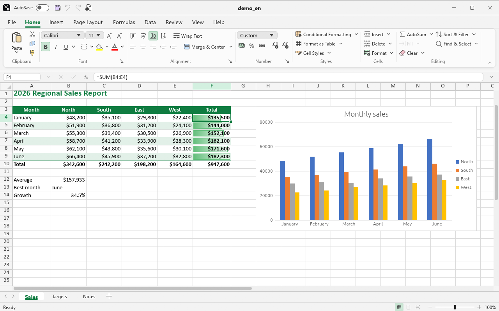

<p align="center">
  
</p>

<h1 align="center">Vellum Grid</h1>

<p align="center">
  <b>A fast, open source spreadsheet that works offline.</b><br>
  Written in Rust. Runs on Linux, Windows and in the browser.
</p>

<p align="center">
  <a href="https://github.com/mfurkan46/vellum-grid/actions/workflows/ci.yml"></a>
  <a href="https://github.com/mfurkan46/vellum-grid/releases/latest"></a>
  <a href="#license"></a>
  
</p>

<p align="center">
  <b>English</b> · <a href="readme/README_tr.md">Türkçe</a>
</p>

<p align="center">
  <a href="#download">Download</a> ·
  <a href="#features">Features</a> ·
  <a href="#building-from-source">Build</a> ·
  <a href="CHANGELOG.md">Changelog</a> ·
  <a href="CONTRIBUTING.md">Contributing</a>
</p>

<p align="center">
  <picture>
    <source media="(prefers-color-scheme: dark)" srcset="assets/screenshots/dark.png">
    
  </picture>
</p>

---

Vellum Grid is built for everyday office spreadsheet work: editing cells, formulas, formatting, sorting and filtering, charts, multiple sheets and `.xlsx` files. It has a familiar ribbon interface, the keyboard shortcuts you already know, Turkish and English interfaces, and light and dark themes. Anyone who has used a spreadsheet before can start working without learning anything new.

It is the first application of **Vellum**, a family of simple, fast and private office tools. The other members (word processor, text editor, PDF viewer and an app hub) are planned.

## Highlights

- **Fast.** Compiled to native code. The virtual grid draws only the visible cells and stays smooth with 1,048,576 rows. Only the cells affected by a change are recalculated.
- **Private.** Your data stays on your device. No account, no cloud, no telemetry, no ads. It never connects to the network.
- **Compatible.** Reads and writes `.xlsx` and `.ods`, opens `.xls` and `.csv`. Files you save open in other office programs.
- **Familiar.** Ribbon, File screen, context menus, formula bar and shortcuts work the way you expect.
- **Bilingual.** Turkish and English interfaces. Formulas follow the interface language (`=TOPLA(A1;B1)` or `=SUM(A1,B1)`), while files are always stored in the language-independent form.
- **Cross-platform.** Linux (Pardus first), Windows and the browser (WebAssembly).

## Download

Prebuilt packages are attached to every [release](https://github.com/mfurkan46/vellum-grid/releases/latest):

| Platform | File | Notes |
|---|---|---|
| Windows 10/11 (x64) | `vellum-grid-<version>-windows-x86_64.zip` | Single executable. Run `install.ps1` for a Start menu entry and file associations. |
| Pardus / Debian / Ubuntu (x64) | `vellum-grid_<version>_amd64.deb` | `sudo apt install ./vellum-grid_<version>_amd64.deb` |
| Other Linux (x64) | `vellum-grid-<version>-linux-x86_64.tar.gz` | Single executable. |

Release notes for each version are in the [changelog](CHANGELOG.md).

## Features

<details open>
<summary><b>Cells and navigation</b></summary>

- Virtual grid with row and column headers and a Name Box.
- Keyboard and mouse selection; Ctrl+Arrow jumps to the edge of the data.
- Copy, cut and paste with relative reference adjustment; Paste Special (values, formulas, formats, operations, transpose); 100 levels of undo and redo.
- Insert and delete cells, rows and columns; formulas, merges, filters, conditional formats and charts move with them.
- Drag the selection border to move cells (Ctrl to copy); Ctrl+click for multiple selections.
- Go To and Go To Special (blanks, constants, formulas, current region, last cell, visible cells).
- AutoComplete while typing, Alt+Enter for a new line in a cell, F4 to cycle `$` references.
- AutoRecover: unsaved work is backed up every minute and can be restored after a crash.
</details>

<details>
<summary><b>Formulas</b></summary>

- 113 functions, with Turkish and English names (SUM, IF, VLOOKUP, XLOOKUP, SUMIFS, INDEX, MATCH, SUBTOTAL, TEXT, NETWORKDAYS…).
- Insert Function dialog with search, categories and descriptions; function and name suggestions while typing; argument tips.
- Named ranges: Name Manager, Define Name, Create from Selection, naming from the Name Box.
- Colored references while editing; trace precedents and dependents; error checking (green triangles, warning button, Error Checking dialog); automatic or manual calculation.
- Pick references with the mouse or the arrow keys; circular reference detection.
</details>

<details>
<summary><b>Formatting</b></summary>

- Font, size, bold, italic, underline, color, fill, borders and alignment from the ribbon; wrap text and merge cells.
- Number formats: currency, accounting, percentage, date, scientific and custom codes.
- Format Cells: number, alignment (angle, vertical text, indent, shrink to fit), font, border (13 line styles, diagonals), fill (patterns), protection.
- Cell Styles gallery and Format Painter.
- Tables: 60 table styles, header and total rows, banded rows and columns, structured references (`Table1[Column]`, `[@Column]`), automatic expansion, Convert to Range.
- Conditional formatting: highlight and top/bottom rules, dates, formula rules, data bars, color scales, icon sets and a rules manager.
</details>

<details>
<summary><b>Data</b></summary>

- Fill series (numbers, dates, month and day names, numbered text) and Flash Fill.
- Multi-level sort with Turkish alphabetical order.
- AutoFilter: value lists, number, date and text conditions with wildcards, top 10, above/below average, dynamic dates, filter by color; Advanced Filter.
- Data Validation: drop-down lists, number, date, time and length limits, custom formulas, input messages, error alerts, circle invalid data.
- Text to Columns, Remove Duplicates, text and CSV import with encoding and delimiter choice.
- Row and column grouping with outline buttons, Subtotal.
- Freeze panes, Find and Replace with wildcards.
</details>

<details>
<summary><b>Charts and objects</b></summary>

- Column, bar, line, area, pie, doughnut and scatter charts; clustered, stacked and 100% stacked subtypes; axis titles, data labels, legend position and gridlines.
- Sparklines: line, column and win/loss, with high, low, first, last and negative point markers.
- Pictures (PNG, JPEG, GIF, BMP), shapes (lines, arrows, rectangles, basic shapes, block arrows, stars) and text boxes with fill, outline and text formatting.
- Everything can be moved and resized and is saved to `.xlsx`.
</details>

<details>
<summary><b>Review</b></summary>

- Notes and threaded comments, the Comments pane, convert notes to comments.
- Hyperlinks to web pages, files, places in the workbook and e-mail addresses.
- Sheet protection (permission options, password), workbook structure protection, locked cells and hidden formulas.
- Spell checking with built-in Turkish and English (US) dictionaries and a personal dictionary.
</details>

<details>
<summary><b>Files, printing and appearance</b></summary>

- `.xlsx` read and write: formats, column widths, merges, filters, conditional formats, tables, charts, sparklines, pictures, shapes, page setup, notes, comments, hyperlinks and protection are kept.
- `.ods` read and write, `.xls` read, CSV in UTF-8 and Windows-1254.
- File screen: New, Open and Recent, Info, Save, Save As, Print, Export.
- Page setup: paper size, orientation, margins, scaling or fit to page, print area, print titles, headers and footers, page breaks.
- Print preview, Page Break Preview, PDF export with embedded fonts.
- Light, dark or system theme; in the dark theme the sheet can be dark (colors inverted) or white. Turkish or English interface. Settings are shared by all Vellum applications.
</details>

## Building from source

Vellum Grid needs [Rust](https://rustup.rs) 1.95 or later.

```bash
git clone https://github.com/mfurkan46/vellum-grid.git
cd vellum-grid
cargo build --release
```

The application is created as `target/release/vellum-grid` (`vellum-grid.exe` on Windows). To open a file directly, pass its path:

```bash
vellum-grid budget.xlsx
```

<details>
<summary><b>Linux requirements</b></summary>

On Debian, Ubuntu and Pardus:

```bash
sudo apt install build-essential libxkbcommon-dev libgl1-mesa-dev libwayland-dev libx11-dev
```
</details>

<details>
<summary><b>Windows requirements</b></summary>

The MSVC toolchain works without extra setup. With the GNU toolchain (`stable-x86_64-pc-windows-gnu`) a full MinGW-w64 installation (for example WinLibs) is needed in a path **without spaces**, with its `bin` folder on `PATH`. The GNU build also embeds the application icon with `windres`.
</details>

<details>
<summary><b>Web (WebAssembly)</b></summary>

```bash
rustup target add wasm32-unknown-unknown
cargo install wasm-bindgen-cli --version 0.2.129
cargo build -p vellum-grid --release --target wasm32-unknown-unknown
wasm-bindgen --target web --no-typescript --out-dir crates/app/web/pkg target/wasm32-unknown-unknown/release/vellum_grid.wasm
python -m http.server --directory crates/app/web
```

The `wasm-bindgen-cli` version must match the `wasm-bindgen` version in `Cargo.lock`.
</details>

## Installation

### Windows

No administrator rights are needed. From the extracted release folder (or after building from source):

```powershell
powershell -ExecutionPolicy Bypass -File install.ps1
```

When building from source, the script is at `packaging\windows\install.ps1`. It copies the program to `%LOCALAPPDATA%\Programs\Vellum Grid`, adds a Start menu entry and an entry in Settings > Apps, and registers:

- **New > Vellum Grid Worksheet** in the desktop and folder context menu,
- **Open with Vellum Grid** for `.xlsx`, `.xlsm`, `.xls`, `.ods` and `.csv` files.

On Windows 11 these entries appear under "Show more options". Run `uninstall.ps1` to remove everything.

### Pardus / Debian

```bash
sudo apt install ./vellum-grid_<version>_amd64.deb
```

To build the package yourself: `sh packaging/linux/build-deb.sh`. The package installs the application, the menu entry and icons, and registers the spreadsheet file types.

## Formulas

```
=IF(SUM(B2:B10)>1000,"high","low")
=VLOOKUP("Apple",A:C,3,FALSE)
=SUMIF(D:D,">=100",E:E)
```

With the Turkish interface the same formulas are written with Turkish names and separators (`=EĞER(TOPLA(B2:B10)>1000;"yüksek";"düşük")`) and numbers use `1.234,56`. Files always store the English form, so a workbook opens the same way in either language.

## Keyboard shortcuts

<details>
<summary>Show the full list</summary>

| Shortcut | Action |
|---|---|
| Arrow keys, Enter, Tab (Shift to go back) | Move between cells |
| Shift + Arrow | Extend the selection |
| Ctrl + Arrow | Jump to the edge of the data |
| Ctrl + Home / Ctrl + End | A1 / last used cell |
| Ctrl + Space / Shift + Space | Select column / row |
| Ctrl + A | Select all |
| F2, double-click | Edit the cell |
| Ctrl + C / X / V | Copy / cut / paste |
| Ctrl + Alt + V | Paste Special |
| Ctrl + D / Ctrl + R | Fill down / right |
| Ctrl + + / Ctrl + - | Insert / delete cells |
| F5, Ctrl + G | Go To |
| Shift + F3 | Insert Function |
| F9 / Shift + F9 | Calculate now / calculate sheet |
| Ctrl + F3 / Ctrl + Shift + F3 | Name Manager / Create from Selection |
| Tab (while suggestions are open) | Insert the suggested function or name |
| Alt + Enter | New line in a cell |
| F4 (while editing) | Toggle absolute and relative references |
| Ctrl + click | Multiple selection |
| Ctrl + Z / Ctrl + Y | Undo / redo |
| Ctrl + B / I / U | Bold / italic / underline |
| Ctrl + 1 | Format Cells |
| Alt + = | AutoSum |
| Ctrl + F / Ctrl + H | Find / Replace |
| Ctrl + Shift + L | Filter |
| Ctrl + E | Flash Fill |
| Alt + ↓ | Open the validation or total row list |
| Ctrl + T / Ctrl + L | Create table |
| Shift + F2 | New or edit note |
| Ctrl + Alt + M | New comment |
| Ctrl + K | Insert hyperlink |
| F7 | Spelling |
| Shift + Alt + → / ← | Group / ungroup |
| Ctrl + PageUp / PageDown | Previous / next sheet |
| Ctrl + F1 | Collapse the ribbon |
| Ctrl + N / O / S, F12 | New / open / save / save as |
| Ctrl + P | Print |
</details>

## Command-line tool

`vellum-grid-cli` loads a CSV file, edits it and exports it again. It always uses the English formula language.

```
vellum-grid-cli <input.csv> [command]...
```

| Command | Description |
|---|---|
| `get <cell>` | Print the value of a cell (formulas are calculated) |
| `set <cell> <value>` | Write a value or formula (`=SUM(A1:A3)`); a leading `'` stores text |
| `clear <cell>` | Clear a cell |
| `export <file\|->` | Write the sheet as CSV (`-` for standard output) |

```bash
vellum-grid-cli budget.csv get B2 set B2 1250.50 set C5 "=B2*2" export budget-new.csv
```

## Project structure

```
crates/
  core/   vellum-grid-core   cells, values, sheets, formula engine, formats, sorting, chart model
  io/     vellum-grid-io     xlsx / xls / ods / csv reading and writing, clipboard format, PDF
  app/    vellum-grid        desktop and web application (egui)
  ui/     vellum-ui          shared look of the Vellum applications: theme, ribbon, menus, dialogs, languages, settings
  cli/    vellum-grid-cli    command-line tool
assets/   logos, icons, fonts and screenshots
packaging/ Windows install scripts, Debian package
```

The engine comes first: all spreadsheet logic lives in `vellum-grid-core`, which knows nothing about the user interface, the file system or the platform, and is covered by unit tests. The desktop application and the CLI are thin clients on top of it.

## Contributing

Bug reports, ideas and pull requests are welcome. Please read [CONTRIBUTING.md](CONTRIBUTING.md) before opening a pull request.

## License

Licensed under either of

- Apache License, Version 2.0 ([LICENSE-APACHE](LICENSE-APACHE))
- MIT license ([LICENSE-MIT](LICENSE-MIT))

at your option.

Third-party assets:

- Fluent UI System Icons, MIT ([assets/fonts/LICENSE-FLUENT.txt](assets/fonts/LICENSE-FLUENT.txt))
- Turkish spelling dictionary by Harun Reşit Zafer, MIT ([crates/app/dict/LICENSE-tr_TR](crates/app/dict/LICENSE-tr_TR))
- English (US) spelling dictionary derived from SCOWL by Kevin Atkinson ([crates/app/dict/LICENSE-en_US](crates/app/dict/LICENSE-en_US))

Unless you explicitly state otherwise, any contribution intentionally submitted for inclusion in the work by you, as defined in the Apache-2.0 license, shall be dual licensed as above, without any additional terms or conditions.
