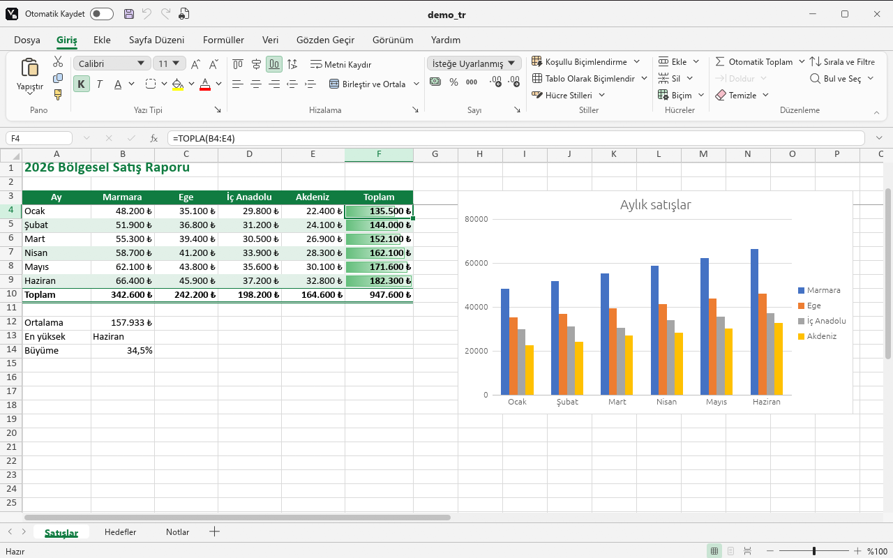

<p align="center">
  
</p>

<h1 align="center">Vellum Grid</h1>

<p align="center">
  <b>Hızlı, açık kaynak ve çevrimdışı çalışan bir hesap tablosu.</b><br>
  Rust ile yazıldı. Linux, Windows ve tarayıcıda çalışır.
</p>

<p align="center">
  <a href="https://github.com/mfurkan46/vellum-grid/actions/workflows/ci.yml"></a>
  <a href="https://github.com/mfurkan46/vellum-grid/releases/latest"></a>
  <a href="#lisans"></a>
  
</p>

<p align="center">
  <a href="../README.md">English</a> · <b>Türkçe</b>
</p>

<p align="center">
  <a href="#indirme">İndirme</a> ·
  <a href="#özellikler">Özellikler</a> ·
  <a href="#kaynaktan-derleme">Derleme</a> ·
  <a href="../CHANGELOG.md">Sürüm notları</a> ·
  <a href="../CONTRIBUTING.md">Katkıda bulunma</a>
</p>

<p align="center">
  <picture>
    <source media="(prefers-color-scheme: dark)" srcset="../assets/screenshots/dark-tr.png">
    
  </picture>
</p>

---

Vellum Grid, ofiste her gün yapılan tablo işleri için tasarlandı: hücre düzenleme, formüller, biçimlendirme, sıralama ve filtre, grafikler, çoklu sayfa ve `.xlsx` dosyaları. Tanıdık bir şeritli arayüzü, alışılmış klavye kısayolları, Türkçe ve İngilizce arayüzü, açık ve koyu teması vardır. Tablo programı kullanmış herkes yeni bir şey öğrenmeden çalışabilir.

**Vellum** ailesinin ilk uygulamasıdır. Vellum; sade, hızlı ve kullanıcısına ait ofis araçlarından oluşan bir ailedir. Diğer üyeler (kelime işlemci, metin düzenleyici, PDF görüntüleyici ve uygulama merkezi) planlanıyor.

## Öne çıkanlar

- **Hızlı.** Yerel kod olarak derlenir. Sanal ızgara yalnızca görünen hücreleri çizer, 1.048.576 satırda bile akıcıdır. Bir değişiklikte yalnızca etkilenen hücreler yeniden hesaplanır.
- **Gizli.** Veriler cihazda kalır. Hesap, bulut, telemetri ve reklam yoktur. Uygulama ağa bağlanmaz.
- **Uyumlu.** `.xlsx` ve `.ods` okur ve yazar, `.xls` ve `.csv` açar. Kaydedilen dosyalar diğer ofis programlarında açılır.
- **Tanıdık.** Şerit, Dosya ekranı, sağ tık menüleri, formül çubuğu ve kısayollar alıştığınız gibi çalışır.
- **İki dilli.** Türkçe ve İngilizce arayüz. Formüller arayüz dilini izler (`=TOPLA(A1;B1)` veya `=SUM(A1,B1)`); dosyalara her zaman dilden bağımsız biçimde kaydedilir.
- **Her yerde.** Linux (Pardus öncelikli), Windows ve tarayıcı (WebAssembly).

<a name="indirme"></a>

## İndirme

Hazır paketler her [sürümün](https://github.com/mfurkan46/vellum-grid/releases/latest) altında bulunur:

| Platform | Dosya | Not |
|---|---|---|
| Windows 10/11 (x64) | `vellum-grid-<sürüm>-windows-x86_64.zip` | Tek dosyalık program. Başlat menüsü ve dosya ilişkilendirmeleri için `install.ps1` çalıştırılır. |
| Pardus / Debian / Ubuntu (x64) | `vellum-grid_<sürüm>_amd64.deb` | `sudo apt install ./vellum-grid_<sürüm>_amd64.deb` |
| Diğer Linux (x64) | `vellum-grid-<sürüm>-linux-x86_64.tar.gz` | Tek dosyalık program. |

Her sürümün notları [sürüm notlarında](../CHANGELOG.md) (İngilizce) yer alır.

## Özellikler

<details open>
<summary><b>Hücreler ve gezinme</b></summary>

- Sanal ızgara, satır/sütun başlıkları ve Ad Kutusu.
- Klavye ve fareyle seçim; Ctrl+ok ile veri kenarına atlama.
- Kopyala/kes/yapıştır (göreli başvurular kayar), Özel Yapıştır (değerler, formüller, biçimler, işlemler, devrik dönüşüm); 100 adım geri al/yinele.
- Hücre, satır ve sütun ekleme/silme; formüller, birleştirmeler, filtreler, koşullu biçimler ve grafikler buna göre kayar.
- Seçimi kenarından sürükleyerek taşıma (Ctrl ile kopyalama), Ctrl+tıklama ile çoklu seçim.
- Git ve Özel Git (boşluklar, sabitler, formüller, geçerli bölge, son hücre, görünür hücreler).
- Yazarken otomatik tamamlama, Alt+Enter ile hücre içinde yeni satır, F4 ile `$` başvuru döngüsü.
- Otomatik kurtarma: kaydedilmemiş çalışma her dakika yedeklenir, beklenmedik kapanıştan sonra geri açılabilir.
</details>

<details>
<summary><b>Formüller</b></summary>

- Türkçe ve İngilizce adlarıyla 113 işlev (TOPLA, EĞER, DÜŞEYARA, ÇAPRAZARA, ÇOKETOPLA, İNDİS, KAÇINCI, ALTTOPLAM, METNEÇEVİR, İŞGÜNÜ…).
- `1.234,56` sayı biçimi, `;` bağımsız değişken ayırıcısı, `DOĞRU`/`YANLIŞ`, Türkçe hata adları.
- İşlev Ekle penceresi (arama, kategori, açıklama), yazarken işlev ve ad önerileri, bağımsız değişken ipucu.
- Adlandırılmış aralıklar: Ad Yöneticisi, Ad Tanımla, Seçimden Oluştur, Ad Kutusu'ndan ad verme.
- Düzenlerken renkli başvurular; etkileyenleri ve bağımlıları izleme; hata denetimi (yeşil üçgen, uyarı düğmesi, Hata Denetimi penceresi); otomatik veya el ile hesaplama.
- Fareyle ve ok tuşlarıyla başvuru seçme, döngüsel başvuru tespiti.
</details>

<details>
<summary><b>Biçimlendirme</b></summary>

- Şeritten yazı tipi, boyut, kalın/italik/altı çizili, renk, dolgu, kenarlık ve hizalama; metni kaydırma, hücre birleştirme.
- Sayı biçimleri: para birimi, finansal, yüzde, tarih, bilimsel ve özel kodlar.
- Hücreleri Biçimlendir: sayı, hizalama (açı, dikey metin, girinti, sığdırmak için daralt), yazı tipi, kenarlık (13 çizgi, çapraz), dolgu (desenler), koruma.
- Hücre Stilleri galerisi ve Biçim Boyacısı.
- Tablolar: 60 tablo stili, başlık ve toplam satırı, bantlı satır/sütun, yapılandırılmış başvurular (`Tablo1[Sütun]`, `[@Sütun]`), otomatik genişleme, Aralığa Dönüştür.
- Koşullu biçimlendirme: vurgulama ve üst/alt kuralları, tarihler, formül kuralları, veri çubukları, renk ölçekleri, simge kümeleri ve kural yöneticisi.
</details>

<details>
<summary><b>Veri</b></summary>

- Seri doldurma (sayı, tarih, ay ve gün adları, numaralı metin) ve Hızlı Doldurma.
- Türkçe alfabe sırasıyla çok düzeyli sıralama.
- Otomatik filtre: değer listesi, joker karakterli sayı/tarih/metin koşulları, ilk 10, ortalamanın üstü/altı, dinamik tarihler, renge göre filtre; Gelişmiş Filtre.
- Veri Doğrulama: açılır liste, sayı/tarih/saat/uzunluk sınırları, özel formül, giriş iletisi, hata uyarısı, geçersiz verileri daire içine alma.
- Metni Sütunlara Dönüştür, Yinelenenleri Kaldır, kodlama ve ayırıcı seçmeli metin/CSV içe aktarma.
- Satır/sütun gruplandırma ve anahat düğmeleri, Alt Toplam.
- Bölmeleri dondurma, joker karakterli bul ve değiştir.
</details>

<details>
<summary><b>Grafikler ve nesneler</b></summary>

- Sütun, çubuk, çizgi, alan, pasta, halka ve dağılım grafikleri; kümelenmiş, yığılmış ve %100 yığılmış alt türler; eksen başlıkları, veri etiketleri, gösterge konumu ve kılavuz çizgileri.
- Mini grafikler: çizgi, sütun ve kazanç/kayıp; yüksek, düşük, ilk, son ve negatif noktalar.
- Resimler (PNG, JPEG, GIF, BMP), şekiller (çizgi, ok, dikdörtgen, temel şekiller, blok oklar, yıldızlar) ve metin kutuları; dolgu, anahat ve metin biçimi.
- Hepsi taşınır, boyutlandırılır ve `.xlsx` dosyasına kaydedilir.
</details>

<details>
<summary><b>Gözden Geçir</b></summary>

- Notlar ve yanıtlı açıklamalar, Açıklamalar bölmesi, notları açıklamaya dönüştürme.
- Web sayfası, dosya, belgedeki yer ve e-posta köprüleri.
- Sayfa koruma (izin seçenekleri, parola), çalışma kitabı yapısını koruma, hücre kilidi ve formül gizleme.
- Gömülü Türkçe ve İngilizce (ABD) sözlüklerle yazım denetimi, kullanıcı sözlüğü.
</details>

<details>
<summary><b>Dosyalar, yazdırma ve görünüm</b></summary>

- `.xlsx` okuma/yazma: biçimler, sütun genişlikleri, birleştirmeler, filtreler, koşullu biçimler, tablolar, grafikler, mini grafikler, resimler, şekiller, sayfa yapısı, notlar, açıklamalar, köprüler ve koruma korunur.
- `.ods` okuma/yazma, `.xls` okuma, UTF-8 ve Windows-1254 CSV.
- Dosya ekranı: Yeni, Aç ve Son Kullanılanlar, Bilgi, Kaydet, Farklı Kaydet, Yazdır, Dışarı Aktar.
- Sayfa yapısı: kâğıt boyutu, yönlendirme, kenar boşlukları, ölçek veya sayfaya sığdırma, yazdırma alanı, yinelenen başlıklar, üst/alt bilgi, sayfa sonları.
- Baskı önizlemesi, Sayfa Sonu Önizleme, yazı tipleri gömülü PDF çıktısı.
- Açık, koyu veya sistem teması; koyu temada belge zemini koyu (renkler ters çevrilir) veya beyaz olabilir. Türkçe veya İngilizce arayüz. Ayarlar bütün Vellum uygulamalarında ortaktır.
</details>

## Kaynaktan derleme

[Rust](https://rustup.rs) 1.95 veya üstü gerekir.

```bash
git clone https://github.com/mfurkan46/vellum-grid.git
cd vellum-grid
cargo build --release
```

Uygulama `target/release/vellum-grid` (Windows'ta `vellum-grid.exe`) olarak oluşur. Bir dosyayı doğrudan açmak için yolunu argüman olarak verin:

```bash
vellum-grid butce.xlsx
```

<details>
<summary><b>Linux gereksinimleri</b></summary>

Debian, Ubuntu ve Pardus için:

```bash
sudo apt install build-essential libxkbcommon-dev libgl1-mesa-dev libwayland-dev libx11-dev
```
</details>

<details>
<summary><b>Windows gereksinimleri</b></summary>

MSVC araç zinciri ek bir şey gerektirmez. GNU araç zinciriyle (`stable-x86_64-pc-windows-gnu`) derlerken tam bir MinGW-w64 (ör. WinLibs) **boşluk içermeyen** bir klasörde kurulu ve `bin` klasörü `PATH`'te olmalıdır. GNU derlemesi uygulama simgesini `windres` ile exe'ye gömer.
</details>

<details>
<summary><b>Web (WebAssembly)</b></summary>

```bash
rustup target add wasm32-unknown-unknown
cargo install wasm-bindgen-cli --version 0.2.129
cargo build -p vellum-grid --release --target wasm32-unknown-unknown
wasm-bindgen --target web --no-typescript --out-dir crates/app/web/pkg target/wasm32-unknown-unknown/release/vellum_grid.wasm
python -m http.server --directory crates/app/web
```

`wasm-bindgen-cli` sürümü `Cargo.lock`'taki `wasm-bindgen` sürümüyle aynı olmalıdır.
</details>

## Kurulum

### Windows

Yönetici izni gerekmez. Sürüm arşivini açtığınız klasörde (veya kaynaktan derledikten sonra):

```powershell
powershell -ExecutionPolicy Bypass -File install.ps1
```

Kaynaktan derlendiğinde betik `packaging\windows\install.ps1` konumundadır. Program `%LOCALAPPDATA%\Programs\Vellum Grid` altına kopyalanır, Başlat menüsüne ve Ayarlar > Uygulamalar listesine eklenir; ayrıca şunlar kaydedilir:

- Masaüstü ve klasör sağ tık menüsünde **Yeni > Vellum Grid Çalışma Sayfası**,
- `.xlsx`, `.xlsm`, `.xls`, `.ods` ve `.csv` dosyalarında **Vellum Grid ile Aç**.

Windows 11'de bu öğeler "Daha fazla seçenek göster" altında görünür. Kaldırmak için `uninstall.ps1` çalıştırılır.

### Pardus / Debian

```bash
sudo apt install ./vellum-grid_<sürüm>_amd64.deb
```

Paketi kendiniz oluşturmak için: `sh packaging/linux/build-deb.sh`. Paket uygulamayı, menü girdisini ve simgeleri kurar, tablo dosya türlerini kaydeder.

## Formüller

```
=EĞER(TOPLA(B2:B10)>1000;"yüksek";"düşük")
=DÜŞEYARA("Elma";A:C;3;YANLIŞ)
=ETOPLA(D:D;">=100";E:E)
```

Arayüz İngilizce olduğunda aynı formüller İngilizce adlar ve ayırıcılarla yazılır (`=IF(SUM(B2:B10)>1000,"high","low")`). Dosyalarda her zaman İngilizce biçim saklanır; böylece bir dosya iki dilde de aynı açılır.

| Türkçe | İngilizce | Türkçe | İngilizce |
|---|---|---|---|
| TOPLA | SUM | SOLDAN | LEFT |
| ORTALAMA | AVERAGE | SAĞDAN | RIGHT |
| MİN | MIN | PARÇAAL | MID |
| MAK | MAX | UZUNLUK | LEN |
| BAĞ_DEĞ_SAY | COUNT | ARALIKBİRLEŞTİR | CONCAT |
| BAĞ_DEĞ_DOLU_SAY | COUNTA | BİRLEŞTİR | CONCATENATE |
| EĞER | IF | YUVARLA | ROUND |
| EĞERHATA | IFERROR | MUTLAK | ABS |
| VE | AND | BUGÜN | TODAY |
| YADA | OR | DÜŞEYARA | VLOOKUP |
| DEĞİL | NOT | ÇAPRAZARA | XLOOKUP |
| ETOPLA | SUMIF | EĞERSAY | COUNTIF |

## Klavye kısayolları

<details>
<summary>Tüm listeyi göster</summary>

| Kısayol | İşlev |
|---|---|
| Ok tuşları, Enter, Tab (Shift ile geri) | Hücreler arasında gezinme |
| Shift + ok | Seçimi genişletme |
| Ctrl + ok | Veri bloğunun kenarına atlama |
| Ctrl + Home / Ctrl + End | A1 / son dolu hücre |
| Ctrl + Space / Shift + Space | Sütun / satır seçme |
| Ctrl + A | Tümünü seçme |
| F2, çift tıklama | Hücreyi düzenleme |
| Ctrl + C / X / V | Kopyala / kes / yapıştır |
| Ctrl + Alt + V | Özel Yapıştır |
| Ctrl + D / Ctrl + R | Aşağı / sağa doldur |
| Ctrl + + / Ctrl + - | Hücre ekle / sil |
| F5, Ctrl + G | Git |
| Shift + F3 | İşlev Ekle |
| F9 / Shift + F9 | Şimdi hesapla / sayfayı hesapla |
| Ctrl + F3 / Ctrl + Shift + F3 | Ad Yöneticisi / Seçimden Ad Oluştur |
| Tab (öneri listesi açıkken) | Önerilen işlevi veya adı ekle |
| Alt + Enter | Hücre içinde yeni satır |
| F4 (düzenlerken) | Başvuruyu mutlak/göreli yapma |
| Ctrl + tıklama | Çoklu seçim |
| Ctrl + Z / Ctrl + Y | Geri al / yinele |
| Ctrl + B / I / U | Kalın / italik / altı çizili |
| Ctrl + 1 | Hücreleri Biçimlendir |
| Alt + = | Otomatik Toplam |
| Ctrl + F / Ctrl + H | Bul / Değiştir |
| Ctrl + Shift + L | Filtre |
| Ctrl + E | Hızlı Doldurma |
| Alt + ↓ | Doğrulama veya toplam satırı listesini aç |
| Ctrl + T / Ctrl + L | Tablo oluştur |
| Shift + F2 | Not ekle / düzenle |
| Ctrl + Alt + M | Yeni açıklama |
| Ctrl + K | Köprü ekle |
| F7 | Yazım denetimi |
| Shift + Alt + → / ← | Gruplandır / grubu çöz |
| Ctrl + PageUp / PageDown | Önceki / sonraki sayfa |
| Ctrl + F1 | Şeridi daralt |
| Ctrl + N / O / S, F12 | Yeni / aç / kaydet / farklı kaydet |
| Ctrl + P | Yazdır |
</details>

## Komut satırı aracı

`vellum-grid-cli` bir CSV dosyasını yükler, düzenler ve yeniden dışa aktarır. Her zaman İngilizce formül dilini kullanır.

```
vellum-grid-cli <girdi.csv> [komut]...
```

| Komut | Açıklama |
|---|---|
| `get <hücre>` | Hücre değerini yazdırır (formüller hesaplanır) |
| `set <hücre> <değer>` | Değer veya formül yazar (`=SUM(A1:A3)`); `'` ile başlayan değer metin olarak saklanır |
| `clear <hücre>` | Hücreyi siler |
| `export <dosya\|->` | Sayfayı CSV olarak yazar (`-` standart çıktı) |

```bash
vellum-grid-cli butce.csv get B2 set B2 1250.50 set C5 "=B2*2" export butce-yeni.csv
```

## Proje yapısı

```
crates/
  core/   vellum-grid-core   hücre, değer, sayfa, formül motoru, biçimler, sıralama, grafik modeli
  io/     vellum-grid-io     xlsx / xls / ods / csv okuma-yazma, pano biçimi, PDF
  app/    vellum-grid        masaüstü ve web uygulaması (egui)
  ui/     vellum-ui          Vellum uygulamalarının ortak görünümü: tema, şerit, menüler, iletişim kutuları, diller, ayarlar
  cli/    vellum-grid-cli    komut satırı aracı
assets/   logolar, simgeler, yazı tipleri ve ekran görüntüleri
packaging/ Windows kurulum betikleri, Debian paketi
```

Motor önceliklidir: bütün tablo mantığı arayüzden, dosya sisteminden ve platformdan bağımsız `vellum-grid-core` kütüphanesindedir ve birim testleriyle korunur. Masaüstü uygulaması ve CLI bu çekirdeğin ince istemcileridir.

## Katkıda bulunma

Hata bildirimleri, öneriler ve çekme istekleri memnuniyetle karşılanır. Çekme isteği açmadan önce lütfen [CONTRIBUTING.md](../CONTRIBUTING.md) dosyasını okuyun.

## Lisans

İsteğe bağlı olarak aşağıdakilerden biriyle lisanslanmıştır:

- Apache License, Version 2.0 ([LICENSE-APACHE](../LICENSE-APACHE))
- MIT license ([LICENSE-MIT](../LICENSE-MIT))

Üçüncü taraf içerikler:

- Fluent UI System Icons, MIT ([assets/fonts/LICENSE-FLUENT.txt](../assets/fonts/LICENSE-FLUENT.txt))
- Türkçe yazım sözlüğü, Harun Reşit Zafer, MIT ([crates/app/dict/LICENSE-tr_TR](../crates/app/dict/LICENSE-tr_TR))
- İngilizce (ABD) yazım sözlüğü, Kevin Atkinson'ın SCOWL projesinden ([crates/app/dict/LICENSE-en_US](../crates/app/dict/LICENSE-en_US))

Aksini açıkça belirtmediğiniz sürece, bu projeye katkı olarak gönderdiğiniz her çalışma, Apache-2.0 lisansında tanımlandığı şekilde, ek koşul olmadan yukarıdaki çift lisansla lisanslanmış sayılır.
